# Audit Report: `flutter_staggered_grid_view_plus`

**Deliverable Date:** 2026-10-20  
**Package:** `flutter_staggered_grid_view_plus`  
**Successor To:** `flutter_staggered_grid_view` (v0.7.0, unmaintained since July 30, 2023)  
**Author / Auditor:** Pair-Programming AI Assistant  

---

## 1. Executive Summary

`flutter_staggered_grid_view` is **fully revivable and in viable condition**, with the core package code (`lib/`) containing **0 compilation errors** and passing all **25 existing unit tests** on modern Flutter 3.47.7 and Dart 3.13.5. 

The scope to achieve a first publishable release (**v0.1.0**) with complete API parity and production safety is **small to medium (1.5 to 2 developer days)**. The primary tasks are bumping the obsolete `<3.0.0` Dart constraint, applying a defensive clamp against the known Issue #362 negative constraint crash, fixing the example app's deprecated Material 2 `headline6` reference, exporting missing delegate classes, updating `cacheExtent` deprecations, and configuring pub.dev repository metadata.

---

## 2. Environment & Base Clone Details

| Parameter | Value |
| :--- | :--- |
| **OS** | Windows 11 Enterprise (x86_64) |
| **Flutter Version** | `3.47.7` (channel stable, 2026-10-08) |
| **Dart Version** | `3.13.5` (DevTools `2.60.0`) |
| **Original Repo URL** | `https://github.com/letsar/flutter_staggered_grid_view` |
| **Original Commit Hash** | `0bfd05f285a6ecf390a8927e6ad4e67f7a39979b` |
| **Original Branch & Tag** | `master` @ tag `v0.7.0` |
| **Original Last Commit Date** | `Sun Jul 30 14:04:57 2023 +0200` |
| **Original Last Commit Msg**| `Bump version to 0.7.0` (Romain Rastel) |
| **Target Working Folder** | `C:\Projects\pub.dev\flutter_staggered_grid_view_plus` |
| **Reference Clone Folder** | `C:\Projects\pub.dev\_original_flutter_staggered_grid_view` (untouched) |

---

## 3. Exact Test, Analysis, and Format Results

### 3.1 `flutter pub get`
- **Root Package:** Ran cleanly (code 0). Added 24 dependencies from Flutter SDK.
- **Examples Subproject:** Ran cleanly (code 0). Resolved `flutter_staggered_grid_view_plus` via local path `../`.

### 3.2 `flutter analyze`
Across the entire repository (root package + examples), static analysis initially reported **99 issues** prior to resolving `examples/`, which reduced to **15 issues** once the subproject's dependencies were indexed:

| Category | Errors | Warnings | Infos | Total |
| :--- | :---: | :---: | :---: | :---: |
| **`lib/` (Core Package)** | **0** | **1** | **8** | **9** |
| **`test/` (Unit Tests)** | **0** | **0** | **0** | **0** |
| **`examples/` (Sample App)**| **2** | **0** | **4** | **6** |
| **Total** | **2** | **1** | **12** | **15** |

#### Detailed Issues Breakdown:
1. **Core Package (`lib/`)**:
   - `warning` - `TODO(romain): Can be optimized` at `lib\src\layouts\sliver_patterned_grid_delegate.dart:145:8` (`todo` lint enabled as a warning in `analysis_options.yaml`).
   - `info` (8 occurrences) - `'cacheExtent' is deprecated and shouldn't be used. Use scrollCacheExtent instead. This feature was deprecated after v3.41.0-0.0.pre.`
     - `lib\src\widgets\aligned_grid_view.dart:91:11`
     - `lib\src\widgets\aligned_grid_view.dart:149:11`
     - `lib\src\widgets\aligned_grid_view.dart:207:11`
     - `lib\src\widgets\masonry_grid_view.dart:121:11`
     - `lib\src\widgets\masonry_grid_view.dart:184:11`
     - `lib\src\widgets\masonry_grid_view.dart:227:11`
     - `lib\src\widgets\masonry_grid_view.dart:293:11`
     - `lib\src\widgets\masonry_grid_view.dart:359:11`

2. **Example App (`examples/`)**:
   - `error` (2 occurrences) - `The getter 'headline6' isn't defined for the type 'TextTheme'.`:
     - `examples\lib\main.dart:125:28`
     - `examples\lib\main_examples.dart:125:28`
   - `info` (2 occurrences) - `'withOpacity' is deprecated and shouldn't be used. Use .withValues() to avoid precision loss.`:
     - `examples\lib\main.dart:117:39`
     - `examples\lib\main_examples.dart:117:39`
   - `info` (1 occurrence) - `Invalid use of a private type in a public API`:
     - `examples\lib\common.dart:113:3` (`library_private_types_in_public_api`)
   - `info` (1 occurrence) - `The imported package 'collection' isn't a dependency of the importing package`:
     - `examples\lib\pages\staggered.dart:1:8` (`depend_on_referenced_packages`)

### 3.3 `dart format --output=none --set-exit-if-changed .`
- **Output:** `Formatted 42 files (0 changed) in 0.04 seconds.`
- **Exit Code:** `0` (100% compliant with standard Dart format conventions).

### 3.4 `flutter test`
- **Result:** **25 passed, 0 failed, 0 skipped.** (Total run time: ~5.4 seconds).
- **Test files executed (8 total):**
  - `test/src/layouts/quilted_test.dart` (1 test)
  - `test/src/layouts/staired_test.dart` (3 tests)
  - `test/src/layouts/woven_test.dart` (3 tests)
  - `test/src/widgets/aligned_grid_view_test.dart` (3 tests)
  - `test/src/widgets/masonry_grid_view_test.dart` (4 tests)
  - `test/src/widgets/staggered_grid_test.dart` (3 tests)
  - `test/src/widgets/staggered_grid_tile_test.dart` (5 tests)
  - `test/src/widgets/uniform_track_test.dart` (3 tests)

### 3.5 Example App Run / Build Test
- `flutter build bundle` was executed inside `examples/`.
- **Result:** **Failed with Exit Code 1.**
  ```text
  lib/main.dart:125:28: Error: The getter 'headline6' isn't defined for the type 'TextTheme'.
  Try correcting the name to the name of an existing getter, or defining a getter or field named 'headline6'.
                            .headline6!
                             ^^^^^^^^^
  Target kernel_snapshot_program failed: Exception
  ```
- **Conclusion:** The example app does **NOT** run on modern Flutter without updating `headline6` to `titleLarge`. Additionally, the Android configuration uses deprecated AGP 4.1.0, Kotlin 1.3.50, Gradle 6.7, and legacy `flutter.gradle` scripts.

---

## 4. Findings Grouped by Severity

### Critical Severity

#### 1. GitHub Issue #362 Runtime Assertion Crash (`BoxConstraints` Negative Dimensions)
- **Files & Lines:** `lib/src/rendering/staggered_grid.dart:289, 305, 314-315`
- **Description:** When a staggered grid is laid out inside a container with 0 or constrained width/height (such as dialog popups, page route transitions, drawer slide-ins, animated containers, or zero-width viewport passes), the stride computation produces negative dimensions:
  `crossAxisExtent = stride * crossAxisCellCount - crossAxisSpacing`
  `mainAxisExtent = stride * mainAxisCellCount - mainAxisSpacing`
  These negative numbers are fed into `BoxConstraints.tight(childSize)`, throwing an unhandled `FlutterError`:  
  `BoxConstraints has both a negative minimum width and a negative minimum height`.
- *(See Section 5 for deep dive and proposed fix).*

#### 2. Division by Zero & Empty Reduction Crash on Zero Extent
- **Files & Lines:** 
  - `lib/src/rendering/staggered_grid.dart:111, 269, 336`
  - `lib/src/rendering/sliver_simple_grid_delegate.dart:121-124`
- **Description:** When `maxCrossAxisExtent` delegates receive `crossAxisExtent == 0`, `(0 / (max + spacing)).ceil()` returns `0`. Consequently:
  - `stride = (0 + spacing) / 0` evaluates to `double.infinity`.
  - `offsets = List.filled(0, 0.0)` allocates an empty array.
  - `offsets.reduce(math.max)` throws `StateError: No element`.

#### 3. Systemic Negative Dimensions in Other Layout Delegates
- **Files & Lines:**
  - `lib/src/layouts/quilted.dart:63-65, 142` (`assert(cellExtent > 0)` crashes on zero cross-axis)
  - `lib/src/rendering/uniform_track.dart:124, 134-141` (computes negative childMainAxisExtent)
  - `lib/src/layouts/woven.dart:81-83, 115-117` (generates negative `Rect.fromLTWH` and sizes)
- **Description:** The pattern `(extent + spacing) / count - spacing` without bounding `math.max(0.0, ...)` is duplicated across all delegates. Zero or sub-spacing widths trigger assertion crashes across all grid types.

#### 4. Obsolete SDK Constraints Blocking Modern Pub Ecosystem
- **Files & Lines:** `pubspec.yaml:7`
- **Description:** `environment: sdk: ">=2.12.0 <3.0.0"`. Dart 3.0+ removed the legacy non-null-safety migration layer. The `<3.0.0` upper bound produces resolution warnings, prevents publishing to pub.dev, and blocks modern Flutter 3.x installations.

#### 5. Example App Compilation Failure on Current Flutter
- **Files & Lines:** `examples/lib/main.dart:125:28`, `examples/lib/main_examples.dart:125:28`
- **Description:** Uses `Theme.of(context).textTheme.headline6!` which was removed in Flutter's Material 3 migration. Prevents `examples` from compiling.

---

### High Severity

#### 1. Deprecated `cacheExtent` in ScrollViews
- **Files & Lines:** 
  - `lib/src/widgets/aligned_grid_view.dart:91, 149, 207`
  - `lib/src/widgets/masonry_grid_view.dart:121, 184, 227, 293, 359`
- **Description:** Passes `cacheExtent` to `BoxScrollView` / `CustomScrollView`. Flutter 3.41+ deprecated `cacheExtent` in favor of `scrollCacheExtent`.

#### 2. Hidden Public API: Missing `StaggeredGridDelegate` Export
- **Files & Lines:** `lib/flutter_staggered_grid_view.dart:1-14` (GitHub Issue #344)
- **Description:** `StaggeredGrid.custom` requires a `StaggeredGridDelegate`, but `src/rendering/staggered_grid.dart` is not exported by the package barrel file. Users are forced to import `package:.../src/rendering/staggered_grid.dart`, violating Dart encapsulation best practices.

#### 3. Pub.dev Example Discovery Failure (`example` vs `examples`)
- **Files & Lines:** `example/README.md:1` vs `examples/`
- **Description:** Pub.dev requires an `example/` (singular) directory with valid Dart code. The repository has an empty `example/README.md` and keeps its code in `examples/` (plural). Pub.dev assigns 0 points for documentation examples under this structure.

#### 4. Ancient Android Gradle Setup in Examples
- **Files & Lines:** 
  - `examples/android/build.gradle:2, 9` (AGP 4.1.0, Kotlin 1.3.50)
  - `examples/android/gradle/wrapper/gradle-wrapper.properties:6` (Gradle 6.7)
  - `examples/android/app/build.gradle:26` (`apply from: "$flutterRoot/.../flutter.gradle"`)
- **Description:** Modern Flutter CLI fails on AGP < 7.x, Gradle < 7.5, and deprecated `flutter.gradle` scripts when building on JDK 17 or JDK 21.

#### 5. Multi-SliverMasonryGrid Scroll Offset Desynchronization
- **Files & Lines:** `lib/src/rendering/sliver_masonry_grid.dart:215-225` (GitHub Issues #338, #335, #299, #286, #265)
- **Description:** `RenderSliverMasonryGrid` assumes its top-most scroll offset is always `0.0`. When multiple `SliverMasonryGrid` widgets reside in a single `CustomScrollView`, subsequent slivers jump or fail to layout children when scrolled into view.

---

### Medium Severity

#### 1. Missing pub.dev Metadata
- **Files & Lines:** `pubspec.yaml:4-5`
- **Description:** Missing `repository`, `issue_tracker`, and `topics:` tags (`grid`, `staggered-grid`, `masonry`, `layout`, `widgets`).

#### 2. Decoupling Material Dependency for Flutter 2026 Modularization
- **Files & Lines:** 
  - `lib/src/layouts/quilted.dart:3`
  - `lib/src/layouts/sliver_patterned_grid_delegate.dart:3`
  - `lib/src/layouts/staired.dart:1`
  - `lib/src/widgets/aligned_grid_view.dart:2`
  - `lib/src/widgets/masonry_grid_view.dart:2`
  - `lib/src/widgets/sliver_masonry_grid.dart:1`
  - `lib/src/widgets/staggered_grid.dart:1`
  - `lib/src/widgets/staggered_grid_tile.dart:1`
  - `lib/src/widgets/uniform_track.dart:3`
- **Description:** 9 files in `lib/` import `package:flutter/material.dart`, but only use `widgets.dart` and `rendering.dart` classes (`BoxScrollView`, `ScrollPhysics`, `Clip`, etc.). In Flutter 2026, Material is being decoupled into the standalone `material_ui` package. Changing imports to `package:flutter/widgets.dart` will keep this package pure and dependency-free.

#### 3. Deprecated `Color.withOpacity`
- **Files & Lines:** `examples/lib/main.dart:117:39`, `examples/lib/main_examples.dart:117:39`
- **Description:** Deprecated in Flutter 3.27+; must be `.withValues(alpha: ...)`.

#### 4. Intrinsic Dimensions Collapse to Zero
- **Files & Lines:** `lib/src/rendering/staggered_grid.dart:225-243`
- **Description:** `computeMinIntrinsicWidth`, `computeMaxIntrinsicWidth`, `computeMinIntrinsicHeight`, and `computeMaxIntrinsicHeight` return a constant `0`. Placing `StaggeredGrid` inside `IntrinsicHeight` or `IntrinsicWidth` causes complete layout collapse.

#### 5. Analyzer Warning for Legacy TODO Comment
- **Files & Lines:** `lib/src/layouts/sliver_patterned_grid_delegate.dart:145:8`
- **Description:** `// TODO(romain): Can be optimized.` triggers an analyzer warning because `analysis_options.yaml:8` declares `todo: warning`.

---

### Low Severity

#### 1. Missing CI Automation
- **Files & Lines:** `.github/`
- **Description:** No `.github/workflows` exists. CI should be established to run format, analyze, test, and dry-run publish.

#### 2. Undocumented Public APIs
- **Files & Lines:** Various files in `lib/src/`
- **Description:** Some private types leak into public signatures (e.g. `examples/lib/common.dart:113:3`).

#### 3. Missing Unit Test Edge Cases
- **Files & Lines:** `test/`
- **Description:** Tests only test standard 800x600 LTR screens. Missing:
  - 0-constraint layout tests
  - RTL tests
  - Dynamic children count updates
  - Reverse orientation tests
  - Golden widget tests

---

## 5. Issue #362 Deep Dive: Root Cause & Proposed Fix

### 5.1 Context & Trace
- **GitHub Issue:** [#362](https://github.com/letsar/flutter_staggered_grid_view/issues/362) (reported September 2025).
- **Error:**
  ```text
  The following assertion was thrown during performLayout():
  BoxConstraints has both a negative minimum width and a negative minimum height.
  These invalid constraints were provided to RenderSemanticsGestureHandler's layout() function by the
  following function, which probably computed the invalid constraints in question:
    _layoutChild (package:flutter_staggered_grid_view/src/rendering/staggered_grid.dart:470:9)
  The offending constraints were:
    BoxConstraints(w=-3.0, h=-3.0; NOT NORMALIZED)
  ```

### 5.2 Root Cause Analysis
In `RenderStaggeredGrid._computeSize` (`staggered_grid.dart:264-316`):
```dart
final crossAxisExtent = mainAxis == Axis.vertical
    ? constraints.maxWidth
    : constraints.maxHeight;
final crossAxisCount = delegate.getCrossAxisCount(crossAxisExtent, crossAxisSpacing);
final stride = (crossAxisExtent + crossAxisSpacing) / crossAxisCount;
...
final crossAxisExtent = stride * crossAxisCellCount - crossAxisSpacing;
...
mainAxisExtent = mainAxisFixedExtent ?? stride * mainAxisCellCount - mainAxisSpacing;
...
final childSize = mainAxis == Axis.vertical
    ? Size(crossAxisExtent, mainAxisExtent)
    : Size(mainAxisExtent, crossAxisExtent);
final childConstraints = BoxConstraints.tight(childSize);
layoutChild(child, childConstraints);
```

#### The Mathematics of the Failure:
Suppose a `StaggeredGrid.count` has `crossAxisCount = 4` and `crossAxisSpacing = 12.0`:
1. If the parent container momentarily resizes or lays out at `width = 24.0` (during a modal opening, slide animation, or flexible wrap pass):
   $$\text{stride} = \frac{24.0 + 12.0}{4} = 9.0$$
2. For a tile with `crossAxisCellCount = 1` and `mainAxisCellCount = 1`:
   $$\text{crossAxisExtent} = 9.0 \times 1 - 12.0 = -3.0$$
   $$\text{mainAxisExtent} = 9.0 \times 1 - 12.0 = -3.0$$
3. Both dimensions become **$-3.0$**!
4. `BoxConstraints.tight(Size(-3.0, -3.0))` creates `BoxConstraints(w=-3.0, h=-3.0; NOT NORMALIZED)`.
5. Flutter's `BoxConstraints.debugAssertIsValid` immediately throws an assertion crash.

If `constraints.maxWidth == 0.0`:
$$\text{stride} = \frac{0.0 + \text{spacing}}{\text{count}} = \frac{\text{spacing}}{\text{count}} < \text{spacing}$$
For any grid where $\text{count} \ge 2$, $\text{stride} - \text{spacing}$ is **strictly negative**, guaranteeing an immediate crash on zero-size layout passes!

### 5.3 Proposed Fix
In `lib/src/rendering/staggered_grid.dart`:

```dart
// 1. Guard crossAxisCount >= 1
final crossAxisCount = math.max(
  1, 
  delegate.getCrossAxisCount(crossAxisExtent, crossAxisSpacing),
);

// 2. Compute stride safely
final stride = crossAxisCount > 0 
    ? (crossAxisExtent + crossAxisSpacing) / crossAxisCount 
    : 0.0;

// 3. Clamp child crossAxisExtent to >= 0.0
final rawCrossAxisExtent = stride * crossAxisCellCount - crossAxisSpacing;
final safeCrossAxisExtent = math.max(0.0, rawCrossAxisExtent);

// 4. In shouldFitContent, clamp tight constraints
if (shouldFitContent) {
  final childConstraints = mainAxis == Axis.vertical
      ? BoxConstraints.tightFor(width: safeCrossAxisExtent)
      : BoxConstraints.tightFor(height: safeCrossAxisExtent);
  layoutChild(child, childConstraints, parentUsesSize: true);
  ...
} else {
  // 5. Clamp fixed / proportional mainAxisExtent to >= 0.0
  final rawMainAxisExtent = mainAxisFixedExtent ?? 
      (stride * mainAxisCellCount - mainAxisSpacing);
  final safeMainAxisExtent = math.max(0.0, rawMainAxisExtent);
  childParentData._realMainAxisExtent = safeMainAxisExtent;

  final childSize = mainAxis == Axis.vertical
      ? Size(safeCrossAxisExtent, safeMainAxisExtent)
      : Size(safeMainAxisExtent, safeCrossAxisExtent);
  final childConstraints = BoxConstraints.tight(childSize);
  layoutChild(child, childConstraints);
}

// 6. Prevent empty list reduce crash
final mainAxisExtent = offsets.isEmpty 
    ? 0.0 
    : math.max(0.0, offsets.reduce(math.max) - mainAxisSpacing);
```

Applying equivalent defensive clamping across `sliver_masonry_grid.dart`, `sliver_simple_grid_delegate.dart`, `quilted.dart`, `woven.dart`, and `uniform_track.dart` eliminates all negative-constraint crashes package-wide.

---

## 6. Proposed Upgrade Plan & Estimates

```mermaid
gantt
    title flutter_staggered_grid_view_plus Roadmap
    dateFormat  X
    axisFormat %d d
    section v0.1.0 API Parity
    SDK constraints & metadata        :0, 2
    Issue 362 zero-clamp fix          :1, 3
    Public delegate exports           :2, 3
    cacheExtent deprecation migration :3, 4
    Example app restoration           :3, 5
    CI workflow setup                 :4, 5
    section v0.2.0 Stability
    Multi-Sliver scroll jank fixes    :5, 8
    NullableIndexedWidgetBuilder      :7, 9
    Edge-case & golden tests          :8, 11
    Android Gradle 8+ migration       :9, 11
```



### Phase 1: Release v0.1.0 (First Publishable API-Parity Release)
**Goal:** Drop-in, safe migration for modern Flutter (3.16 - 3.47+) with 100% API parity.
- Bump SDK constraints in `pubspec.yaml` to `sdk: ">=3.0.0 <4.0.0"`, `flutter: ">=3.16.0"`.
- Implement Issue #362 defensive zero-clamping in `RenderStaggeredGrid` and delegates.
- Export `src/rendering/staggered_grid.dart` in `flutter_staggered_grid_view_plus.dart` (Issue #344).
- Migrate `cacheExtent` to `scrollCacheExtent` in `aligned_grid_view.dart` and `masonry_grid_view.dart`.
- Decouple `package:flutter/material.dart` imports to `package:flutter/widgets.dart` in `lib/`.
- Fix example app: `headline6` -> `titleLarge`, `withOpacity` -> `withValues`.
- Reorganize `examples/` -> `example/` for full pub.dev score.
- Create GitHub Actions CI workflow (`build`, `test`, `analyze`, `format`, `publish --dry-run`).
- Fill repository, issue tracker, and topic metadata in `pubspec.yaml`.
- **Effort Estimate:** **1.5 – 2 developer days (12 – 16 hours)**.

### Phase 2: Release v0.2.0 (Stability & Ecosystem Polish)
**Goal:** Address prominent community friction points and scroll performance.
- Resolve multi-sliver offset desynchronization in `RenderSliverMasonryGrid` (Issues #338, #335, #265).
- Add support for `NullableIndexedWidgetBuilder` (`itemBuilder` returning null terminates the list, Issue #365 / #301).
- Add regression unit tests for zero constraints, RTL orientation, and golden tests.
- Modernize example app's Android project to Gradle 8.x, AGP 8.x, Kotlin 2.x, and declarative Gradle plugins.
- **Effort Estimate:** **2 – 3 developer days (16 – 24 hours)**.

### Phase 3: Release v0.3.0+ (New Features & Community Demands)
**Goal:** Modern feature set.
- Implement `MasonryGridView.separated()` (Issue #337, #275).
- Calculate accurate intrinsic dimensions in `RenderStaggeredGrid`.
- Add keyboard focus and navigation support (Issue #288).
- Reorderable / drag-and-drop support (Issue #273, PR #239).
- **Effort Estimate:** **3 – 5 developer days (24 – 40 hours)**.

---

## 7. Risks & Open Questions

1. **GitHub Repository & Issue Tracker URLs:**  
   `pubspec.yaml` contains placeholder TODOs for `homepage`, `repository`, and `issue_tracker`. Please supply your GitHub organization/repository URL (e.g., `https://github.com/<owner>/flutter_staggered_grid_view_plus`) so pub.dev assigns full package points.
2. **Directory Structure (`example` vs `examples`):**  
   Pub.dev mandates `example/` (singular). We recommend renaming the `examples` folder to `example` in the next pass.
3. **Minimum Flutter Target:**  
   We recommend targeting Flutter `>=3.16.0` (Dart `>=3.2.0`), which covers >95% of active Flutter apps while safely supporting modern ScrollView APIs and avoiding deprecated APIs.
4. **Attribution & Trademark:**  
   MIT License and original copyright by Romain Rastel are preserved intact in `LICENSE` and highlighted in `README.md`. No risk of license violation.
